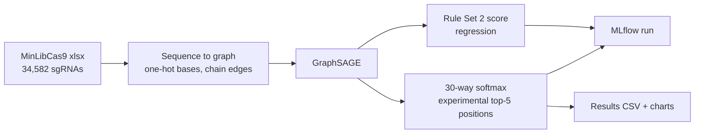

# CRISPR-GNN: Graph Neural Networks for sgRNA Analysis

A learning project that turns CRISPR sgRNA sequences into small graphs and trains a GraphSAGE model on them, then tries an experimental "top-5 cut sites" output with MLflow tracking. The results are early and are reported as they are.


**Live demo:** none. This is a notebook project.
**Notebook:** [Open in Colab](https://colab.research.google.com/drive/17x-48jRMII77jdGR2q6xeQ_Q1IbaZtkf)
**Repo:** [github.com/Machine-Learning-Engineer-1776/CRISPR_Gene_Editing_GNN_Model](https://github.com/Machine-Learning-Engineer-1776/CRISPR_Gene_Editing_GNN_Model)


---

## What it is

| Step | What the code does |
|------|--------------------|
| Data | Loads `13059_2021_2268_MOESM4_ESM.xlsx` and keeps **34,582** sgRNAs with a valid A/T/C/G sequence and a Rule Set 2 score |
| Graphs | Each base is a node (one-hot A/T/C/G); neighbouring bases are linked in both directions |
| Base model | GraphSAGE (GCN variants were also tried) predicting the normalized Rule Set 2 score; 70/15/15 train/val/test split |
| Top-5 extension | GraphSAGE (200 hidden, 2 layers) with a 30-way softmax; `torch.topk` returns the 5 highest-scoring positions per sequence |
| Outputs | Prediction CSV, two charts and an MLflow run |

**Dataset:** Additional file 4 (Table S3, the MinLibCas9 library) from Gonçalves et al., *"Minimal genome-wide human CRISPR-Cas9 library"*, Genome Biology 22:40 (2021), [doi:10.1186/s13059-021-02268-4](https://doi.org/10.1186/s13059-021-02268-4). A copy is in `Required Documents/`.

---

## Results (honest summary)

| Measure | Value | Source |
|---------|-------|--------|
| sgRNA graphs built | 34,582 | notebook output, `IPYNB FILES/CRISPR_Gene_Editing_GNN_Model (1).ipynb` |
| Top-5 run: sequences scored | 5,187 (25,935 predictions) | `Results/top5_cut_sites_predictions.csv` |
| Top-5 run: mean confidence | **0.037** (range 0.034 to 0.039) | same CSV |
| Base model test loss (MSE) | 0.0039 in the base notebook; 0.0023 in the retrain inside the top-5 notebook | the two notebooks' printed outputs |

What these numbers mean:
- **Confidence** is the softmax score the model gives one of 30 positions. Pure guessing would give 1/30, about 0.033. A mean of 0.037 is close to that, so the top-5 output does **not** yet pick out cut sites in a useful way.
- The dataset has **no per-position cut-site labels**. The top-5 head is trained only through the Rule Set 2 target, so its rankings are not checked against ground truth.
- The normalized labels have a variance of about **0.0023**, so a test MSE of 0.0023 to 0.0039 is about what always predicting the mean would score. The model has not yet been shown to beat a simple baseline.
- Some print statements and text cells in the top-5 notebook and its `.py` export still show **projected** figures (for example 0.923 top-1 confidence, a 0.87 safety score and dollar savings). Those values are typed into the code. They are not measured results. See `Results/README.md`.

---

## Architecture



Everything runs in one notebook. There is no server or web app.

---

## How to run

1. Open the [Colab notebook](https://colab.research.google.com/drive/17x-48jRMII77jdGR2q6xeQ_Q1IbaZtkf). The code uses Colab's file upload.
2. Upload `Required Documents/13059_2021_2268_MOESM4_ESM (1).xlsx` when asked.
3. Optionally upload the pre-trained weights `Required Documents/supervised_edgepred.pth`.
4. Run all cells. Run `mlflow ui` to see the logged run.

Dependencies are in `requirements.txt`.

---

## Next steps
- Compare against simple baselines (mean predictor, linear model on one-hot features) and report Spearman correlation, not just MSE
- Train the top-5 head on real position-level labels, or drop it
- Full training runs with fixed seeds and all metrics logged in MLflow

---

## Tech stack
PyTorch, PyTorch Geometric (GraphSAGE / GCN), MLflow, pandas, openpyxl, Matplotlib, Seaborn, Google Colab

## Project structure
```
IPYNB FILES/                 # base GNN notebook + top-5 extension notebook
Required Documents/          # dataset (xlsx) and pre-trained weights (.pth)
Results/                     # prediction CSV, two charts, and a README explaining them
crispr_gnn_with_top_5_alternate_cut_sites.py   # script export of the top-5 notebook
requirements.txt
```

---

Built by Ron Lance, [Alpha Peak Technologies](https://alphapeaktech.com) · [LinkedIn](https://www.linkedin.com/in/ron-lance-49aa2a8/)
